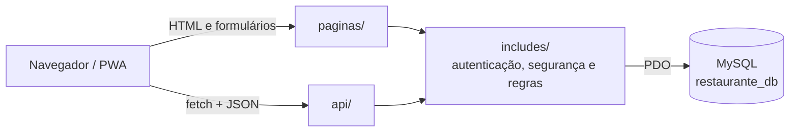
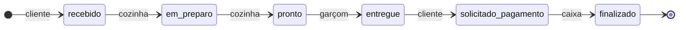

# PedirJá

**Comanda digital por QR Code para restaurantes, padarias e lanchonetes.**

O cliente escaneia o código da mesa, faz o pedido pelo celular e acompanha o preparo. A cozinha e o garçom trabalham em filas atualizadas automaticamente, e o caixa fecha a conta da mesa.


> Projeto acadêmico da disciplina Linguagem de Programação VIII (UNIFEG, Ciência da Computação).

## Sumário

- [Funcionalidades](#funcionalidades)
- [Arquitetura](#arquitetura)
- [Estrutura do projeto](#estrutura-do-projeto)
- [Como executar](#como-executar)
- [Perfis e permissões](#perfis-e-permissões)
- [Regras de negócio](#regras-de-negócio)
- [API](#api)
- [Segurança](#segurança)
- [Testes](#testes)
- [Limitações conhecidas](#limitações-conhecidas)

## Funcionalidades

| Perfil | Recursos |
|--------|----------|
| **Cliente** | Entrada pelo QR Code da mesa, cardápio com fotos e filtro por categoria, carrinho com observação por item, acompanhamento do pedido e solicitação da conta |
| **Cozinha** | Fila em duas colunas (recebidos e em preparo), tempo de espera e avanço de status |
| **Garçom** | Pedidos prontos com a mesa em destaque, aviso de novo pedido e confirmação de entrega |
| **Admin** | Indicadores do dia, caixa, histórico de pedidos, cardápio com envio de fotos, usuários e QR Codes das mesas |

## Arquitetura

Aplicação PHP monolítica, sem framework. As telas consomem uma API JSON do próprio servidor, e as regras de negócio ficam concentradas em `includes/`.



O navegador guarda apenas o cookie de sessão. Identidade, perfil e mesa ficam em `$_SESSION`, no servidor.

### Ciclo de vida do pedido



## Estrutura do projeto

```text
.
├── api/                  Endpoints JSON
│   ├── admin/            Dashboard, caixa, pedidos, usuários, produtos e fotos
│   ├── cliente/          Conta da mesa
│   ├── cozinha/          Fila e mudança de status
│   └── garcom/           Pedidos prontos e entrega
├── assets/
│   ├── css/              Estilos
│   ├── img/              Ícone e fotos do cardápio
│   ├── js/               Lógica de cada tela
│   └── vendor/           Bibliotecas de terceiros
├── banco/
│   ├── banco.sql         Esquema e dados iniciais
│   └── migracoes/        Atualizações de bancos existentes
├── config/               Conexão com o banco (conexao.php fica fora do Git)
├── docs/                 Guia de execução e relatório de validação
├── includes/             Autenticação, segurança, regras de negócio e layout
├── paginas/              Telas da aplicação, manifest e service worker
├── teste/                Painel de testes (somente desenvolvimento)
└── index.php             Ponto de entrada
```

## Como executar

**Pré-requisitos:** [XAMPP](https://www.apachefriends.org/) com PHP 8.2 e MariaDB/MySQL.

```bash
# 1. Clone dentro do htdocs
git clone https://github.com/BrunoSilveira100/pedirja-comanda-digital.git C:/xampp/htdocs/pedirja
cd C:/xampp/htdocs/pedirja

# 2. Crie a configuração local a partir do modelo
cp config/conexao.exemplo.php config/conexao.php
```

3. Inicie **Apache** e **MySQL** no XAMPP Control Panel.
4. Em `http://localhost/phpmyadmin`, aba **SQL**, execute o conteúdo de [`banco/banco.sql`](banco/banco.sql).
5. Acesse `http://localhost/pedirja/`.

> `banco/banco.sql` apaga e recria o banco `restaurante_db`. Em um banco já em uso, aplique os arquivos de [`banco/migracoes/`](banco/migracoes/).

O passo a passo completo, com as contas de demonstração e o acesso pelo celular, está em [`docs/COMO_RODAR.md`](docs/COMO_RODAR.md).

### Acesso pelo celular

Em **Admin → QR Codes das mesas**, o sistema identifica o IP da rede do computador e gera um código por mesa. Celular e computador precisam estar na mesma rede.

## Perfis e permissões

O controle de acesso é feito no servidor, por sessão.

| Situação | Página | API |
|----------|--------|-----|
| Sem login | Redireciona para o login | `401` |
| Perfil sem permissão | Página de acesso negado (`403`) | `403` |

O perfil **admin** tem acesso às áreas de todos os outros perfis. O cadastro público cria apenas clientes; as contas da equipe são criadas pelo admin.

## Regras de negócio

- **Mesa:** definida pelo token do QR Code e guardada na sessão, nunca recebida do navegador.
- **Preço:** o total é calculado no servidor com os valores do banco. Pedido e itens são gravados na mesma transação.
- **Status:** segue o ciclo acima. Transições fora de ordem respondem `409`.
- **Pedido repetido:** o mesmo pedido, do mesmo cliente e mesa, em menos de 10 segundos responde `409`. A verificação ocorre com a mesa travada (`SELECT ... FOR UPDATE`), o que cobre envios simultâneos.
- **Conta:** é da mesa e só pode ser pedida depois que todos os pedidos forem entregues. A partir daí, a mesa não aceita novos pedidos até o fechamento no caixa.
- **Histórico:** produtos e usuários que já aparecem em pedidos não podem ser excluídos.

## API

Todas as respostas são JSON. Requisições `POST`, `PUT`, `PATCH` e `DELETE` exigem o token do `GET /api/csrf.php` no cabeçalho `X-CSRF-Token`.

| Método | Endpoint | Acesso | Descrição |
|--------|----------|--------|-----------|
| `GET` | `/api/csrf.php` | Público | Token CSRF da sessão |
| `POST` | `/api/login.php` | Público | Autenticação |
| `POST` | `/api/cadastro.php` | Público | Cadastro de cliente |
| `POST` | `/api/logout.php` | Logado | Encerra a sessão |
| `GET` | `/api/me.php` | Logado | Usuário e mesa da sessão |
| `GET` | `/api/cardapio.php` | Logado | Produtos disponíveis |
| `GET` `POST` | `/api/pedidos.php` | Cliente | Consulta e cria pedidos |
| `GET` `POST` | `/api/cliente/pagamento.php` | Cliente | Consulta e solicita a conta |
| `GET` | `/api/cozinha/pedidos.php` | Cozinha | Fila de preparo |
| `PUT` | `/api/cozinha/status.php` | Cozinha | Avança o status |
| `GET` | `/api/garcom/pedidos.php` | Garçom | Pedidos prontos |
| `PUT` | `/api/garcom/entregar.php` | Garçom | Confirma a entrega |
| `GET` | `/api/admin/dashboard.php` | Admin | Indicadores do dia |
| `GET` | `/api/admin/pedidos.php` | Admin | Pedidos recentes, com filtro por status |
| `GET` `POST` | `/api/admin/caixa.php` | Admin | Contas abertas e fechamento |
| `GET` `POST` `PUT` `DELETE` | `/api/admin/usuarios.php` | Admin | Gestão de usuários |
| `GET` `POST` `PUT` `DELETE` | `/api/admin/produtos.php` | Admin | Gestão do cardápio |
| `POST` | `/api/admin/produto_imagem.php` | Admin | Envia ou remove a foto de um produto |

**Códigos de status:** `200` sucesso, `201` criado, `400` dados inválidos, `401` não autenticado, `403` sem permissão, `404` não encontrado, `405` método não permitido, `409` conflito de regra, `429` excesso de tentativas, `500` erro interno.

## Segurança

| Risco | Medida |
|-------|--------|
| Senhas | `password_hash` e `password_verify`; o hash nunca sai do servidor |
| SQL Injection | Prepared statements com PDO |
| XSS | Escape na saída do PHP, `textContent` no JavaScript e Content-Security-Policy |
| CSRF | Token por sessão em toda requisição de escrita e cookie `SameSite=Lax` |
| Sessão | Cookie `HttpOnly`, `use_strict_mode`, troca de ID no login e expiração por inatividade |
| Força bruta | Limite de tentativas por IP e e-mail, com resposta `429` |
| Envio de arquivos | Tipo validado pelo conteúdo, limite de 3 MB e nome gerado pelo servidor |
| Clickjacking | `X-Frame-Options: DENY` e `frame-ancestors 'none'` |
| Vazamento de dados | Erros detalhados apenas no log; mensagem de login genérica |
| Credenciais | `config/conexao.php` fora do controle de versão |

## Testes

| Suíte | Cobertura | Resultado |
|-------|-----------|-----------|
| [`docs/validar.php`](docs/validar.php) | Rotas por perfil, fluxo completo do pedido, persistência, segurança, fotos, QR Codes e falhas de banco | 224 de 224 |
| [`teste/`](teste/index.php) | Painel no navegador, com roteiro automático e requisições manuais | 100 de 100 |

O relatório e as instruções para repetir a validação estão em [`docs/VALIDACAO.md`](docs/VALIDACAO.md). O painel `teste/` só responde na própria máquina e deve ser removido antes de uma publicação.

## Limitações conhecidas

- A atualização em tempo real usa consulta periódica (polling), não WebSocket.
- O service worker exige `localhost` ou HTTPS, por regra dos navegadores.
- Fora do ambiente local, o uso de HTTPS é obrigatório, e as contas de demonstração devem ser removidas.
